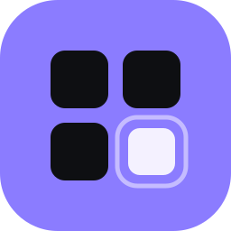
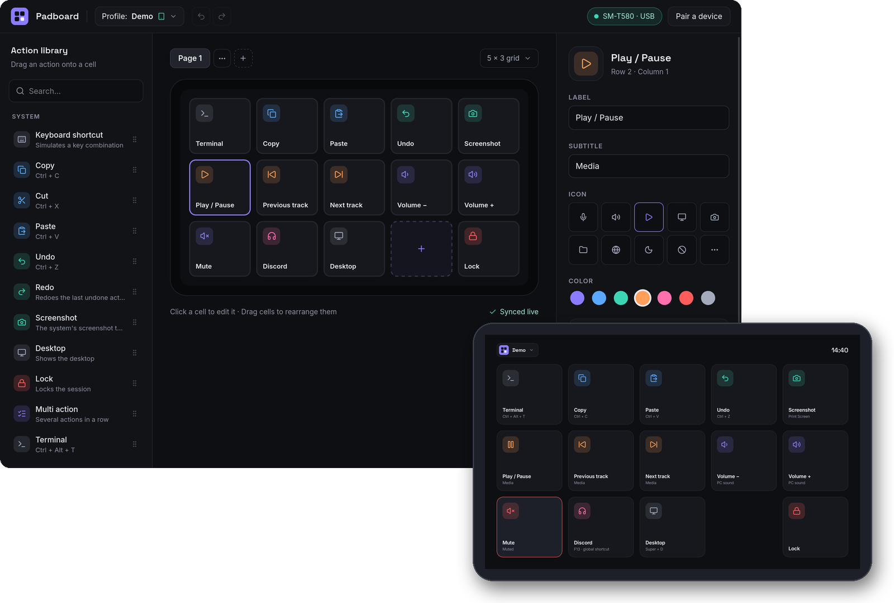

  

# Padboard

Turn an Android tablet into a touch control surface for your PC: a grid of
buttons that run keyboard shortcuts, control the media and the sound, open
apps and websites, or drive OBS Studio. Like a stream deck, with a tablet
you may already have.

- **Desktop app** for Windows 10/11 and Linux: you design the buttons there,
  and it runs the actions.
- **Tablet app** for Android 8+: it shows the buttons and nothing else, and
  can lock a dedicated tablet in kiosk mode.
- Over a **USB cable** (no setup) or **Wi-Fi** (encrypted, paired once with
  a code). No account, no cloud, no ads, no tracking: the PC and the tablet
  only talk to each other, apart from the PC looking for new versions on
  GitHub (which you can turn off).
- Free software (GPL-3.0-or-later), built only with free and open-source
  tools and libraries.

## Install

Download the latest version from the
[releases page](https://github.com/Hugoambiehl/Padboard/releases/latest),
then follow the guide for your system:

- [Windows](docs/install-windows.md): `Padboard_<version>_x64-setup.exe`
- [Linux](docs/install-linux.md) (Ubuntu 22.04+, Debian 12+): `Padboard_<version>_amd64.deb`
- [The tablet](docs/install-tablet.md): `padboard-<version>.apk`, then USB
  or Wi-Fi, and kiosk mode

### Updates

The desktop app looks for a new version at launch, then once a day: it
asks GitHub for the list of Padboard releases, and sends nothing about
you or your PC (GitHub sees the request, like any web page visit). Turn it
off, or ask for test versions (release candidates), in the connections
view, **About** card. On Windows, a new version installs in one click;
the installer is checked first against a signature made by the
maintainer for that exact version. On Linux, the app shows the new
version and its page: install the `.deb` by hand.

## What the buttons can do

| Action | Details |
|---|---|
| Keyboard shortcut | Any key combination, recorded in the editor (keys are stored by physical position) |
| Media | Play/pause, next, previous, stop: the player that is playing, else the media key |
| Volume | Up, down, set to a level, mute the sound output |
| Microphone | Mute or unmute the default microphone |
| Open | A website, a file, a folder or a program |
| Lock | Lock the session |
| Pages and folders | Swipe between pages; a button opens a folder of more buttons |
| Multi action | Several actions in a row, with pauses |
| OBS Studio | Switch scenes, start or stop recording and streaming, mute an audio input |

Buttons show the PC's state live: the microphone or the sound muted, the
media playing, the active OBS scene, REC and LIVE. Each button has a label,
an icon (from [Lucide](https://lucide.dev)) and a color; profiles keep
several sets of pages, and the tablet shows the one you pick.

Windows and Linux (X11 and Wayland) run the same actions; the guides list
the few differences.

## How it works

The desktop app is the brain: it keeps the configuration, runs the actions
and serves the tablet over WebSocket. The tablet only draws what it
receives and sends the presses back.

- **USB**: the desktop app forwards a local port to the tablet through
  `adb reverse` as soon as the tablet is plugged in. The cable is the proof
  of trust: no pairing.
- **Wi-Fi** (off until you turn it on): TLS, a 6-digit code to pair, and
  the tablet then pins the PC's public key. Both screens show the key's
  fingerprint during pairing, to compare.

Details and the security model: [SECURITY.md](SECURITY.md).

## Languages

English and French, following the language of the PC and of the tablet.

## Contributing

Bug reports, ideas and pull requests are welcome: see
[CONTRIBUTING.md](CONTRIBUTING.md), and [docs/development.md](docs/development.md)
to build and test from the sources. Changes between versions:
[CHANGELOG.md](CHANGELOG.md).

## Code signing policy

Every release file is built from this repository by the
[release workflow](.github/workflows/release.yml) on GitHub Actions, from a
tagged commit, and checksums are published with it (`SHA256SUMS`).

- **Tablet app**: the APK built by the workflow is signed on the
  maintainer's PC with the project's release key, which never leaves it
  (certificate SHA-256 in [docs/release-signing.md](docs/release-signing.md)).
- **Updates**: the desktop's in-app updates and the checksums are also
  signed on the maintainer's PC, with a separate key bound to each
  version (`scripts/sign-release.sh`); the app refuses anything else.
- **Windows installer**: not signed yet. A free certificate for open
  source projects has been requested; until then, Windows SmartScreen asks
  for confirmation on first launch.

Team roles:

- Authors and committers: [Hugo Ambiehl](https://github.com/Hugoambiehl)
- Reviewers (changes from contributors): [Hugo Ambiehl](https://github.com/Hugoambiehl)
- Approvers (each signed release): [Hugo Ambiehl](https://github.com/Hugoambiehl)

**Privacy**: this program will not transfer any information to other
networked systems unless specifically requested by the user or the person
installing or operating it. The desktop app talks to your own tablets
(over USB, or over Wi-Fi once you turn it on and pair them), to OBS Studio
if you configure it, and to GitHub to look for new versions: it downloads
the list of releases at launch and daily (nothing about you or your PC is
sent; turn it off in the **About** card) and, when you ask for it, the
update. The tablet app only talks to the PC it is paired with.

## License

Padboard is free software: you can redistribute it and/or modify it under
the terms of the **GNU General Public License, version 3 or later**
([LICENSE](LICENSE)). It comes with no warranty.

Third-party components keep their own licenses, all compatible with the GPL:
Rust crates, npm packages and Android libraries (MIT, Apache-2.0, ISC, BSD,
MPL-2.0…), the [Inter](https://rsms.me/inter/) and
[Space Grotesk](https://fonts.floriankarsten.com/space-grotesk) fonts (SIL
Open Font License 1.1) and the [Lucide](https://lucide.dev) icons (ISC). Both
apps list them with their license texts (*About* → *Licenses*).
